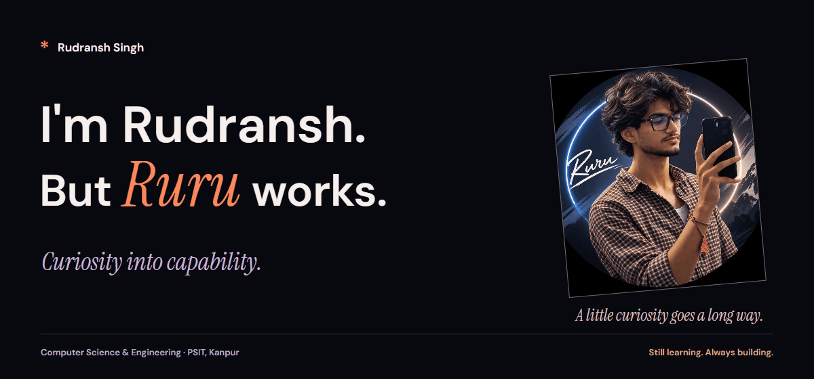
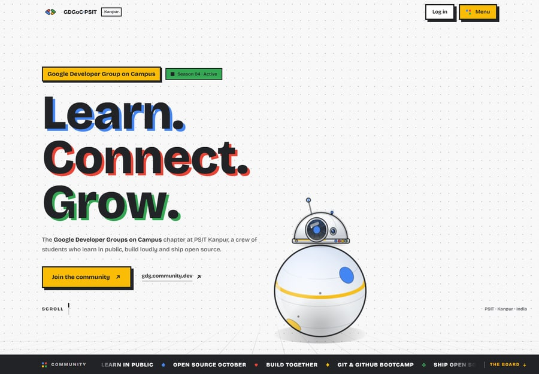
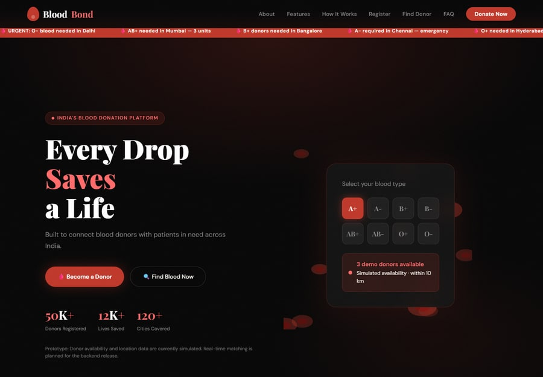
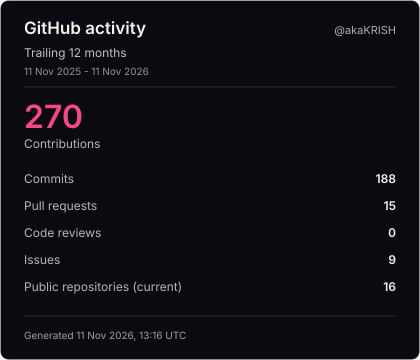
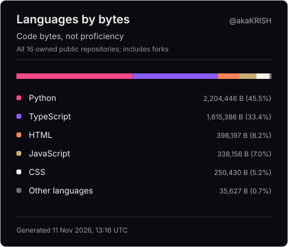
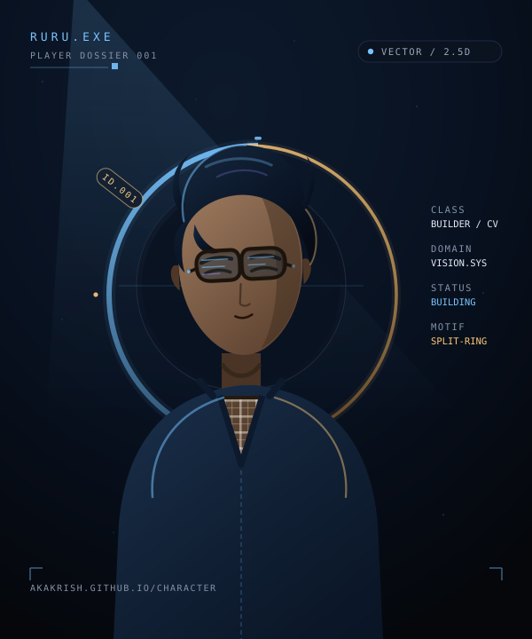
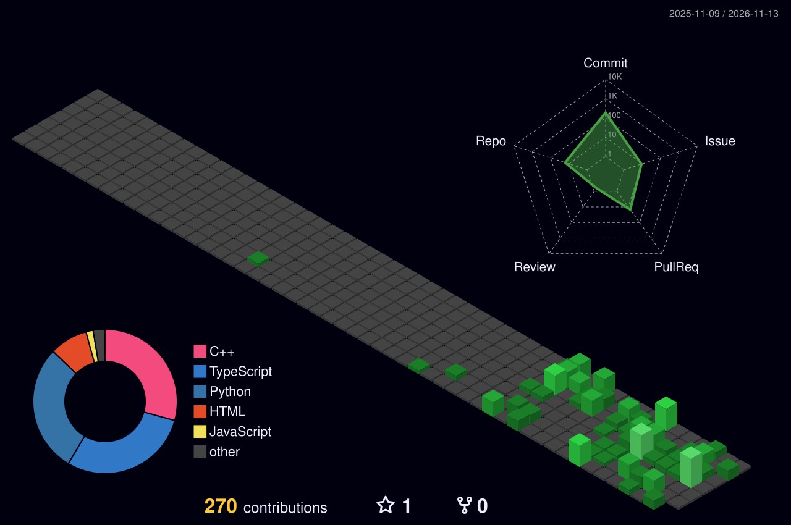
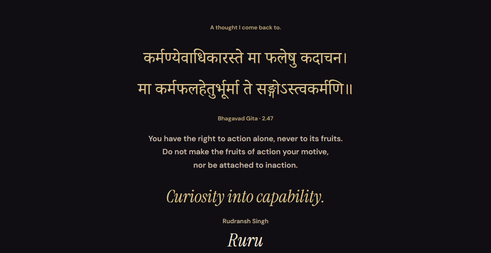

<picture>
  <source media="(prefers-reduced-motion: reduce)" srcset="assets/profile/hero-static.png">
  
</picture>

# Rudransh Singh

**Call me Ruru. Computer Science & Engineering student at PSIT, Kanpur.**

I get curious. I take things apart. Then I try putting them back together in ways they weren't meant to work.

Sometimes that's a computer controlled by hand gestures. Sometimes it's an AI agent that needs to prove it's right. Sometimes it's a website that refuses to behave like one. That's pretty much how I learn.

I'm exploring **computer vision, local-first AI, developer tools, and creative web engineering**. Looking for an internship where I can contribute, ask better questions, and keep building.

[Explore my portfolio](https://akakrish.github.io/ruru-portfolio/) &nbsp; · &nbsp; [Let's talk on LinkedIn](https://linkedin.com/in/akaRudransh-Singh) &nbsp; · &nbsp; [GitHub](https://github.com/akaKRISH)

## Things I Had to Try

### [GestureOS](https://github.com/akaKRISH/GestureOS)

**What if your hands were the interface?** Webcam-based desktop control with hand tracking, explicit interaction states, smoothing, and emergency locking. A [Windows v1.0.0 release](https://github.com/akaKRISH/GestureOS/releases/tag/v1.0.0) is available.

Python · OpenCV · MediaPipe · PySide6

### [ARCEUS](https://github.com/akaKRISH/arceus-core)

**An agent that has to show its working.** Local-first research into metadata retrieval, read-only execution, independent verification, and resource budgets. An experiment with [documented limits](https://github.com/akaKRISH/arceus-core#honest-limitations), not a general autonomous assistant.

Python · SQLite · Ollama

### [PatchPilot](https://github.com/akaKRISH/PatchPilot)

**Try the repair. Keep the original.** A local coding-agent MVP that works in a disposable copy, checks baseline and repair tests, and exports a reviewable patch. Its bundled evaluation is deliberately small.

Python · Ollama · Docker · pytest

### [GDGoC Community Website](https://github.com/akaKRISH/GDGoC-Community-WEBSITE)

**Built with a community, for a community.** My [merged contribution](https://github.com/PSIT-GDGOC/GDGoC-Community-WEBSITE/pull/18) covers event administration and check-in workflows, alongside creative frontend work. [Visit the website](https://gdgoc-community-website.vercel.app).

React · TypeScript · Three.js · Express · MongoDB

### [BloodBond](https://github.com/akaKRISH/BloodBond)

**A simpler way to search for a donor.** A prototype exploring compatibility, availability, and distance-based matching. The [public preview](https://akakrish.github.io/BloodBond/) uses sample data, not a live donor service.

JavaScript · FastAPI · SQLAlchemy · Python

A look at the actual interfaces

**GDGoC Community Website** · Public website capture

**BloodBond** · Prototype capture with sample data

## Tools I Reach For

| Area | Working with |
| :--- | :--- |
| Programming | Python, Java, JavaScript, TypeScript |
| Frontend | React, Tailwind CSS, Vite, Motion, Three.js |
| Backend | Node.js, Express, FastAPI, SQLAlchemy |
| Local AI & vision | OpenCV, MediaPipe, Ollama, local model integration |
| Engineering | Git, GitHub Actions, Docker, pytest |

I'm building fluency through the projects above and [algorithm practice](https://github.com/akaKRISH/LeetCode).

## Away From the Editor

Sprinting gets me out of my head. Psychology, history, and strategy tend to pull me back in. Philosophy keeps me asking which questions are worth the effort, and Krishna's teachings remind me to focus on the work in front of me.

A little activity, not a scoreboard

These self-hosted graphics are generated from GitHub data. Language share measures repository code size, not expertise.

<picture>
  <source media="(prefers-color-scheme: dark)" srcset="assets/snake/github-contribution-grid-snake-dark.svg">
  <source media="(prefers-color-scheme: light)" srcset="assets/snake/github-contribution-grid-snake.svg">
  
</picture>

The original artwork still has a home

The [layered Ruru illustration](character/ruru.svg) is hand-authored work from an earlier version of this profile. I've kept it, along with the original interactive experiments.

[Explore the character study](https://akakrish.github.io/akaKRISH/interactive/character/) &nbsp; · &nbsp; [Explore the contribution field](https://akakrish.github.io/akaKRISH/interactive/)

 

<picture>
  <source media="(max-width: 600px)" srcset="assets/profile/closing-mobile.png">
  
</picture>

Bhagavad Gita 2.47 · Read the verse and meaning

कर्मण्येवाधिकारस्ते मा फलेषु कदाचन।

मा कर्मफलहेतुर्भूर्मा ते सङ्गोऽस्त्वकर्मणि॥

You have the right to action alone, never to its fruits. Do not make the fruits of action your motive, nor be attached to inaction.

[Bhagavad Gita, Chapter 2, Verse 47](https://www.holy-bhagavad-gita.org/chapter/2/verse/47/)

**Curiosity into capability.**

**Rudransh Singh**

*Ruru*

